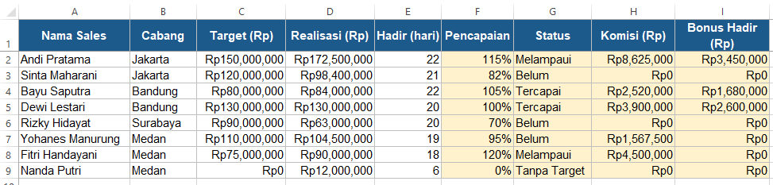
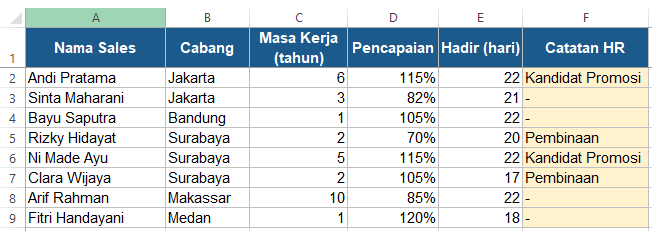
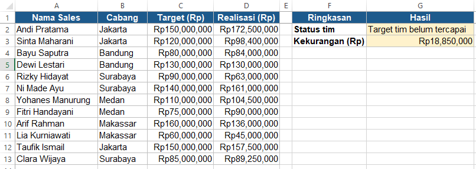

# Studi Kasus Excel: Rekap Komisi dan Evaluasi Tim Sales

Latihan studi kasus dari kursus online (Mahir Rumus IF Excel), dikerjakan ulang di Excel dengan data yang disediakan bersama kasusnya. Sales Manager meminta rekap komisi bulanan, lalu HR meminta catatan evaluasi dan ringkasan tim. Semua permintaan dijawab dengan rumus IF dan turunannya.

| | |
| --- | --- |
| **Tools** | Microsoft Excel |
| **Skill** | `IFERROR`, IF bertingkat, `IFS`, `IF` dengan `AND`/`OR`, `IF` dengan `SUM` |
| **File** | [`komisi-sales-case-study.xlsx`](komisi-sales-case-study.xlsx) |

## 1. Rekap Komisi

**Brief dari Sales Manager:** rekap komisi tim bulan Maret.
1. Pencapaian = realisasi dibagi target. Sales yang belum punya target jangan sampai error.
2. Status: Melampaui (≥110%), Tercapai (≥100%), Belum. Yang tidak punya target ditulis Tanpa Target.
3. Komisi = realisasi dikali tier: ≥110% 5%, ≥100% 3%, ≥90% 1,5%, sisanya 0.
4. Bonus kehadiran 2% dari realisasi, hanya untuk yang target tercapai dan hadir minimal 20 hari.



**Pencapaian:** sales tanpa target diisi 0, bukan error pembagian.
```
=IFERROR(D2/C2, 0)
```

**Status:** target 0 dicek lebih dulu, karena yang menentukan "Tanpa Target" adalah targetnya, bukan pencapaian 0%. Kalau yang dicek pencapaian 0%, sales yang punya target tapi realisasinya 0 akan salah masuk "Tanpa Target". Memakai IF bertingkat supaya tetap bisa dibuka di Excel versi lama.
```
=IF(C2=0, "Tanpa Target", IF(F2>=110%, "Melampaui", IF(F2>=100%, "Tercapai", "Belum")))
```

**Komisi:** tier dicek dari yang tertinggi. Memakai `IFS` supaya tier-nya lebih mudah dibaca.
```
=D2*IFS(F2>=110%, 5%, F2>=100%, 3%, F2>=90%, 1.5%, TRUE, 0)
```

**Bonus Hadir:** kedua syarat harus terpenuhi, jadi memakai `AND`.
```
=IF(AND(E2>=20, F2>=100%), D2*2%, 0)
```

## 2. Catatan HR

**Brief dari HR:** satu kolom catatan untuk evaluasi bulanan. Pencapaian di bawah 80% atau hadir kurang dari 18 hari: Pembinaan. Masa kerja minimal 5 tahun dan pencapaian minimal 110%: Kandidat Promosi. Sisanya strip. Kalau kena dua-duanya, Pembinaan didahulukan.



Karena Pembinaan menjadi prioritas, kondisinya ditaruh paling depan. Salah satu syarat saja sudah cukup (`OR`), sedangkan Kandidat Promosi butuh kedua syarat (`AND`).
```
=IF(OR(D2<80%, E2<18), "Pembinaan", IF(AND(C2>=5, D2>=110%), "Kandidat Promosi", "-"))
```

Contoh pentingnya urutan ini: Clara Wijaya pencapaiannya 105%, tapi hanya hadir 17 hari, sehingga masuk Pembinaan.

## 3. Ringkasan Tim

**Brief dari Sales Manager:** di pojok laporan, tampilkan apakah target tim tercapai, dan kalau belum, kurang berapa rupiah.



Kondisi `IF` membandingkan total, bukan per baris, jadi memakai `SUM` di dalamnya.
```
=IF(SUM(D2:D13)>=SUM(C2:C13), "Target tim tercapai", "Target tim belum tercapai")
=IF(SUM(D2:D13)<SUM(C2:C13), SUM(C2:C13)-SUM(D2:D13), 0)
```

**Hasil:** target tim belum tercapai, dengan kekurangan Rp18.850.000, meskipun beberapa sales melampaui target. Kelebihan dari sales yang melampaui target belum cukup menutup kekurangan sales lain yang realisasinya jauh di bawah target.

## Struktur Folder

```
komisi-sales/
├── README.md
├── komisi-sales-case-study.xlsx
└── screenshots/
    ├── rekap-komisi.png
    ├── catatan-hr.png
    └── ringkasan-tim.png
```
