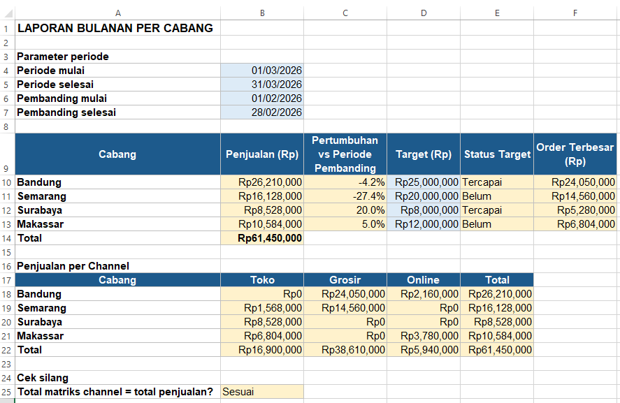

# Studi Kasus Excel: Laporan Bulanan per Cabang

Latihan studi kasus dari kursus online, dikerjakan ulang di Excel dengan data yang disediakan bersama kasusnya. Kepala Area meminta laporan penjualan Maret per cabang untuk rapat area, dengan format yang tetap supaya bulan berikutnya cukup mengganti tanggal. Berbeda dari versi kursus, data transaksi dan laporan ditaruh di sheet terpisah, dan periode pembanding juga dibuat sebagai sel parameter.

| | |
| --- | --- |
| **Tools** | Microsoft Excel |
| **Skill** | `SUMIFS` dengan banyak kriteria, rentang tanggal dari sel parameter, `MAXIFS`, referensi campuran (`$A18`, `B$17`), cek silang |
| **File** | [`laporan-cabang-case-study.xlsx`](laporan-cabang-case-study.xlsx) |

> `MAXIFS` membutuhkan Excel 2019 ke atas atau Microsoft 365.

## Struktur File

| Sheet | Isi |
| --- | --- |
| Transaksi | 16 transaksi Februari dan Maret 2026: tanggal, cabang, kategori, channel, penjualan |
| Laporan | Parameter periode, tabel per cabang, matriks per channel, dan cek silang |

## Brief

**Dari Kepala Area:** siapkan laporan bulanan Maret per cabang untuk rapat area, berisi:
1. Total penjualan Maret per cabang
2. Pertumbuhan dibanding Februari
3. Status target (Tercapai atau Belum)
4. Penjualan Maret per channel per cabang
5. Order terbesar Maret per cabang

Formatnya harus tetap: bulan depan cukup ganti tanggal, semua angka ikut berubah.



## Parameter Periode

Semua rumus mengambil tanggal dari sel parameter, bukan tanggal yang diketik langsung di rumus:

| Sel | Isi |
| --- | --- |
| `B4` dan `B5` | Periode laporan (1-31 Maret 2026) |
| `B6` dan `B7` | Periode pembanding (1-28 Februari 2026) |

Untuk membuat laporan April, cukup ganti keempat tanggal ini.

## Rumus

**Penjualan per cabang:** `SUMIFS` dengan tiga kriteria, yaitu cabang, tanggal mulai, dan tanggal selesai. Batas akhir memakai `"<="` supaya transaksi tanggal 31 Maret tetap terhitung.
```
=SUMIFS(Transaksi!$E$2:$E$17, Transaksi!$B$2:$B$17, $A10, Transaksi!$A$2:$A$17, ">="&$B$4, Transaksi!$A$2:$A$17, "<="&$B$5)
```

**Pertumbuhan:** penjualan periode laporan dibagi penjualan periode pembanding, dikurangi 1.
```
=(B10/SUMIFS(Transaksi!$E$2:$E$17, Transaksi!$B$2:$B$17, $A10, Transaksi!$A$2:$A$17, ">="&$B$6, Transaksi!$A$2:$A$17, "<="&$B$7)) - 1
```

**Status target:**
```
=IF(B10>=D10, "Tercapai", "Belum")
```

**Order terbesar:** `MAXIFS` dengan kriteria yang sama seperti `SUMIFS`.
```
=MAXIFS(Transaksi!$E$2:$E$17, Transaksi!$B$2:$B$17, $A10, Transaksi!$A$2:$A$17, ">="&$B$4, Transaksi!$A$2:$A$17, "<="&$B$5)
```

**Matriks channel:** satu rumus di `B18`, lalu di-copy ke kanan dan ke bawah. Cabang dikunci kolomnya (`$A18`) dan channel dikunci barisnya (`B$17`), sedangkan rentang data dan tanggal dikunci penuh.
```
=SUMIFS(Transaksi!$E$2:$E$17, Transaksi!$B$2:$B$17, $A18, Transaksi!$D$2:$D$17, B$17, Transaksi!$A$2:$A$17, ">="&$B$4, Transaksi!$A$2:$A$17, "<="&$B$5)
```

**Cek silang:** total matriks channel harus sama dengan total penjualan per cabang.
```
=IF(E22=B14, "Sesuai", "Tidak Sesuai")
```

## Hasil

Total penjualan Maret Rp61.450.000. Surabaya tumbuh paling tinggi (20,0%), sedangkan Semarang turun paling dalam (-27,4%). Bandung dan Surabaya mencapai target, sedangkan Semarang dan Makassar belum.

## Struktur Folder

```
laporan-cabang/
├── README.md
├── laporan-cabang-case-study.xlsx
└── screenshots/
    └── laporan-maret.png
```
