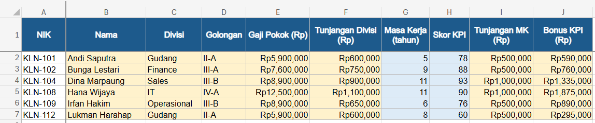
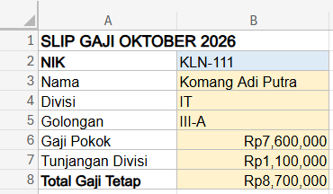

# Studi Kasus Excel: Payroll Oktober dan Slip Gaji Otomatis

Latihan studi kasus dari kursus online (Mahir Lookup Excel), dikerjakan ulang di Excel dengan data yang disediakan bersama kasusnya. HR Manager meminta payroll Oktober dilengkapi dari daftar NIK, lalu pemeriksa payroll meminta template slip gaji yang terisi otomatis. Berbeda dari versi kursus, master karyawan dan tabel referensi ditaruh di sheet terpisah, seperti file payroll sungguhan.

| | |
| --- | --- |
| **Tools** | Microsoft Excel (Microsoft 365) |
| **Skill** | `XLOOKUP` exact dan approximate match, lookup berantai, referensi antarsheet, penanganan data tidak ditemukan |
| **File** | [`payroll-lookup-case-study.xlsx`](payroll-lookup-case-study.xlsx) |

> File ini memakai `XLOOKUP`, sehingga membutuhkan Microsoft 365 atau Excel 2021 ke atas.

## Struktur File

| Sheet | Isi |
| --- | --- |
| Master Karyawan | NIK, nama, divisi, dan golongan 10 karyawan |
| Tabel Golongan | Gaji pokok per golongan |
| Tabel Tunjangan | Tunjangan per divisi |
| Tabel Tier | Tier tunjangan masa kerja dan tier bonus KPI |
| Payroll Oktober | Payroll 6 karyawan, dilengkapi dengan rumus |
| Slip Gaji | Template slip gaji: ketik NIK, semua komponen terisi sendiri |

## 1. Payroll Oktober

**Brief dari HR Manager:** daftar payroll Oktober baru berisi NIK. Lengkapi data karyawan dan semua komponen gaji, dan siapkan sebelum tanggal 22 supaya pemeriksa payroll sempat mengecek.



**Nama, Divisi, Golongan:** dicari dari NIK di sheet Master Karyawan (exact match). Rentang dikunci dengan `$` supaya tidak bergeser saat rumus ditarik ke bawah.
```
=XLOOKUP(A2, 'Master Karyawan'!$A$2:$A$11, 'Master Karyawan'!$B$2:$B$11)
```

**Gaji Pokok dan Tunjangan Divisi:** lookup berantai. Gaji pokok dicari dari golongan, yang juga hasil lookup di kolom sebelumnya; tunjangan dicari dari divisi.
```
=XLOOKUP(D2, 'Tabel Golongan'!$A$2:$A$6, 'Tabel Golongan'!$B$2:$B$6)
=XLOOKUP(C2, 'Tabel Tunjangan'!$A$2:$A$7, 'Tabel Tunjangan'!$B$2:$B$7)
```

**Tunjangan Masa Kerja dan Bonus KPI:** approximate match dengan mode `-1`, yaitu mengambil tier terdekat yang nilainya sama atau lebih kecil. Berbeda dengan `VLOOKUP` versi approximate, cara ini tidak mewajibkan tabel tier diurutkan.
```
=XLOOKUP(G2, 'Tabel Tier'!$A$2:$A$5, 'Tabel Tier'!$B$2:$B$5, , -1)
=E2*XLOOKUP(H2, 'Tabel Tier'!$D$2:$D$5, 'Tabel Tier'!$E$2:$E$5, , -1)
```

Contoh pengecekan batas tier: Lukman Harahap punya skor KPI tepat 60, sehingga masuk tier 5% dan mendapat bonus Rp295.000.

## 2. Slip Gaji Otomatis

**Permintaan lanjutan dari pemeriksa payroll:** template slip gaji per karyawan yang bisa dicetak. Cukup ketik NIK, semua komponen terisi sendiri.



Semua komponen dicari dari sel NIK (`B2`). Argumen keempat `XLOOKUP` (*if_not_found*) dipakai supaya NIK yang salah ketik tidak menghasilkan `#N/A`:
```
=XLOOKUP(B2, 'Master Karyawan'!$A$2:$A$11, 'Master Karyawan'!$B$2:$B$11, "NIK tidak ditemukan")
```

Gaji pokok dan tunjangan memakai hasil golongan dan divisi di slip itu sendiri, dengan nilai 0 kalau tidak ditemukan, sehingga total tetap terhitung:
```
=XLOOKUP(B5, 'Tabel Golongan'!$A$2:$A$6, 'Tabel Golongan'!$B$2:$B$6, 0)
=XLOOKUP(B4, 'Tabel Tunjangan'!$A$2:$A$7, 'Tabel Tunjangan'!$B$2:$B$7, 0)
=B6+B7
```

Contoh: NIK `KLN-111` menghasilkan Komang Adi Putra, IT, golongan III-A, dengan total gaji tetap Rp8.700.000. NIK `KLN-999` menampilkan "NIK tidak ditemukan" dan total Rp0.

## Kalau Pakai Excel Versi Lama

`XLOOKUP` belum ada di Excel 2019 ke bawah. Rumus yang sama bisa ditulis dengan `VLOOKUP` atau `INDEX MATCH`, misalnya untuk mencari nama dari NIK:
```
=VLOOKUP(A2, 'Master Karyawan'!$A$2:$D$11, 2, FALSE)
=INDEX('Master Karyawan'!$B$2:$B$11, MATCH(A2, 'Master Karyawan'!$A$2:$A$11, 0))
```

Untuk tier, `VLOOKUP` memakai `TRUE` di akhir dan tabel tier-nya harus urut dari nilai terkecil. Untuk NIK yang tidak ditemukan, rumusnya dibungkus dengan `IFNA`.

## Struktur Folder

```
payroll-lookup/
├── README.md
├── payroll-lookup-case-study.xlsx
└── screenshots/
    ├── payroll-oktober.png
    └── slip-gaji.png
```
