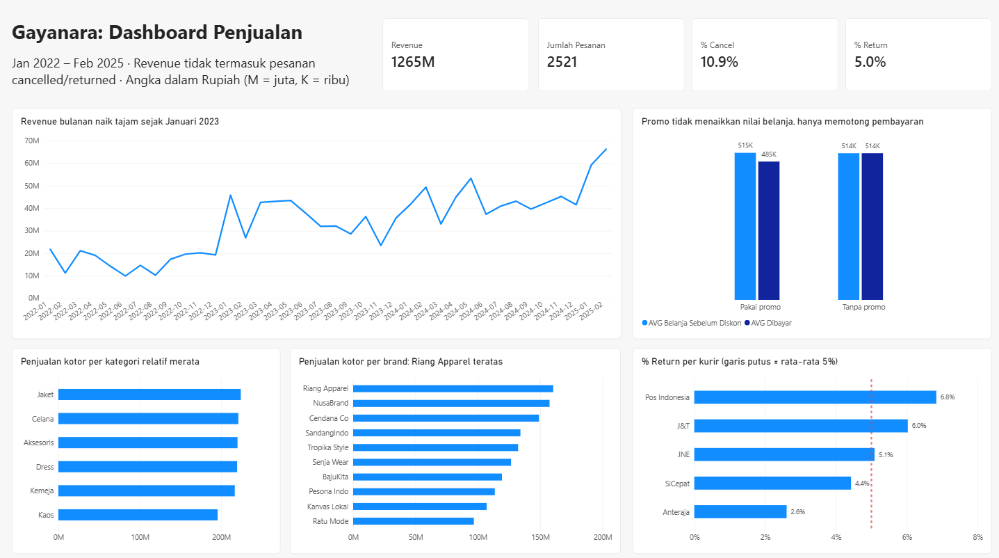

# Gayanara: Analisis Penjualan Toko Fashion Online

Analisis 3.000 pesanan toko fashion online fiktif (2022–2025): data mentah dibersihkan dan dianalisis dengan SQL, lalu disajikan dalam dashboard satu halaman di Power BI.



**[Dashboard (PDF)](dashboard/dashboard.pdf)** · **[Kode SQL](sql/)** · **Tools:** PostgreSQL, Power BI, Excel

## Ringkasan Temuan

- **Revenue naik dari Rp198,8 juta (2022) menjadi Rp513,2 juta (2024)**, dengan lonjakan terbesar di Januari 2023, tanpa pola musiman.
- **Promo tidak menaikkan nilai belanja:** nilai belanja sebelum diskon hampir sama antara pesanan dengan promo (Rp515.199) dan tanpa promo (Rp513.830).
- **Return J&T paling perlu diperhatikan:** 6,0% (rata-rata 5,0%) dengan volume terbesar, sehingga jumlah return-nya paling banyak.
- **358 dari 800 pelanggan punya pesanan sebelum tanggal registrasinya**, sehingga data registrasi tidak dipakai di analisis.

## Rekomendasi

1. Uji ulang strategi promo dengan eksperimen sederhana sebelum memberi diskon besar.
2. Evaluasi tingkat return J&T bersama pihak kurir dan pantau setiap bulan.
3. Catat alasan cancel dan return, serta perbaiki pencatatan tanggal registrasi.

---

<details>
<summary><b>Pertanyaan Bisnis</b></summary>

<br>

1. Bagaimana tren revenue dari tahun ke tahun dan dari bulan ke bulan?
2. Kategori dan brand mana yang paling laku?
3. Apakah promo membuat pelanggan belanja lebih banyak, atau hanya memotong pemasukan?
4. Di mana tingkat cancel dan return paling tinggi: per kurir, metode pembayaran, atau provinsi?

</details>

<details>
<summary><b>Data</b></summary>

<br>

Dataset simulasi (perusahaan fiktif) dari [Ngulik Data](https://ngulikdata.com). Pemilihan pertanyaan, cleaning, analisis, dashboard, dan rekomendasi dikerjakan sendiri.

| Tabel | Baris | Isi |
| --- | --- | --- |
| `orders` | 3.000 | Pesanan Jan 2022 – Feb 2025: tanggal, status, total, promo, kurir, wilayah |
| `order_items` | 4.986 | Item di setiap pesanan |
| `products` | 300 | Katalog produk: kategori, brand, harga |
| `customers` | 800 | Data pelanggan |
| `reviews` | 1.500 | Rating dan ulasan pembeli |

</details>

<details>
<summary><b>Alur Pengerjaan</b></summary>

<br>

1. **Pemeriksaan awal:** setiap tabel dilihat sekilas di Excel (filter per kolom, tanpa mengubah file).
2. **Load:** membuat 5 tabel di PostgreSQL lengkap dengan primary key dan foreign key, lalu mengimpor CSV.
3. **Audit dan cleaning** ([`sql/01_cleaning.sql`](sql/01_cleaning.sql)): memeriksa setiap tabel, mengonfirmasi temuan dengan query, lalu memperbaikinya di tabel baru (`*_clean`). Tabel mentah tidak diubah.
4. **Analisis** ([`sql/02_analysis.sql`](sql/02_analysis.sql)): menjawab 4 pertanyaan bisnis.
5. **Dashboard** ([`gayanara_dashboard.pbix`](gayanara_dashboard.pbix), [PDF](dashboard/dashboard.pdf)): Power BI terhubung langsung ke tabel `*_clean`. Angka di dashboard dicocokkan dengan hasil SQL.

</details>

<details>
<summary><b>Log Cleaning</b></summary>

<br>

| Tabel | Temuan | Keputusan |
| --- | --- | --- |
| products | Kategori punya 14 variasi penulisan (huruf besar/kecil, Indonesia/Inggris, istilah berbeda) | Dirapikan jadi 6 kategori |
| products | 9 produk tanpa `material` | Diisi `'Tidak diketahui'` |
| products | 74 nama produk muncul lebih dari sekali dengan ID dan harga berbeda | Tidak digabung (dianggap varian); analisis memakai `product_id` |
| customers | 3 pasang pelanggan berbeda memakai email yang sama | Email yang tidak cocok dengan nama pelanggan dikosongkan; pelanggan tidak dihapus |
| customers | 40 nomor HP kosong | Dibiarkan kosong, tidak diisi data karangan |
| customers | **358 dari 800 pelanggan memiliki pesanan pertama sebelum tanggal registrasinya** (tidak disebut di dokumentasi dataset) | `registration_date` tidak dipakai; tanggal awal pelanggan memakai tanggal pesanan pertama |
| orders | 1.786 pesanan tanpa `promo_code` dan diskon | Diisi `'Tanpa promo'` dan diskon 0 (kosong memang berarti tanpa promo) |
| orders | Total pesanan terkecil Rp1.000 | Dicek: produk Rp49.000 dengan diskon Rp48.000, bukan error |
| orders, order_items | Total pesanan, subtotal, dan harga dicek silang antartabel | Konsisten, tidak ada yang diubah |
| reviews | Teks ulasan tidak sesuai rating (contoh: "kurang puas" rata-rata rating 4,04) | `review_text` tidak dipakai di analisis; `rating` tetap dipakai |

</details>

<details>
<summary><b>Temuan Lengkap</b></summary>

<br>

**1. Revenue tumbuh, tanpa pola musiman.**
Revenue naik dari Rp198,8 juta (2022) menjadi Rp427,9 juta (2023, +115%) dan Rp513,2 juta (2024, +20%). Lonjakan terbesar terjadi di Januari 2023 (Rp45,8 juta, lebih dari 2x Desember 2022), dan bulan tertinggi adalah Februari 2025. Periode Harbolnas dan Ramadan tidak lebih tinggi dari bulan lain.

**2. Kategori merata; perbedaan ada di brand.**
Setiap kategori menyumbang 15–17% penjualan kotor. Kaos terendah secara total, tetapi produknya paling sedikit; dihitung per produk, Kaos justru di atas Jaket dan Aksesoris. Di level brand, Riang Apparel teratas (12,4%) dan Ratu Mode terbawah (7,5%). Unit terjual tidak selalu sejalan dengan penjualan: Kanvas Lokal laku banyak tapi harga rata-ratanya paling murah (~Rp183 ribu per unit), sedangkan NusaBrand lebih sedikit terjual tapi harganya tertinggi (~Rp310 ribu).

**3. Promo tidak menaikkan nilai belanja.**
Nilai belanja sebelum diskon hampir sama antara pesanan dengan promo (Rp515.199) dan tanpa promo (Rp513.830). Promo hanya mengurangi pembayaran rata-rata sekitar Rp30.661 per pesanan. Kedelapan kode promo dipakai merata dengan rata-rata diskon 10–13%, dan total diskon yang diberikan sekitar Rp31,4 juta.

**4. Return J&T paling perlu diperhatikan.**
Rata-rata keseluruhan: cancel 10,9% dan return 5,0%. J&T return-nya 6,0% dengan volume terbesar, sehingga jumlah return-nya paling banyak. Pos Indonesia lebih tinggi (6,8%) tetapi volumenya kecil. Perbedaan per metode pembayaran kecil. Beberapa provinsi terlihat tinggi, tetapi jumlah pesanannya terlalu sedikit untuk disimpulkan.

</details>

<details>
<summary><b>Rekomendasi Lengkap</b></summary>

<br>

1. **Uji ulang strategi promo.** Jalankan eksperimen sederhana (sebagian pelanggan mendapat promo, sebagian tidak) untuk melihat apakah promo menambah jumlah pembeli. Selama belum terbukti, batasi diskon yang sangat besar.
2. **Evaluasi pengiriman J&T.** Bahas tingkat return dengan pihak kurir dan pantau setiap bulan dengan garis rata-rata 5% sebagai pembanding.
3. **Catat alasan cancel dan return.** Tanpa data alasan, penyebabnya hanya bisa diduga.
4. **Perbaiki pencatatan tanggal registrasi.** Hampir separuh pelanggan punya tanggal registrasi yang tidak masuk akal, sehingga analisis berbasis umur pelanggan belum bisa dipercaya.

</details>

<details>
<summary><b>Batasan</b></summary>

<br>

- Datanya sintetis, sehingga beberapa pola (misalnya tidak ada efek musiman) bisa jadi karena cara data dibuat.
- Diskon dicatat per pesanan, bukan per item, jadi analisis kategori dan brand memakai penjualan kotor (sebelum diskon).
- Data tidak menunjukkan apa yang terjadi seandainya promo tidak ada, sehingga dampak promo terhadap jumlah pembeli belum bisa diukur.

</details>

<details>
<summary><b>Struktur Repository</b></summary>

<br>

```
gayanara-sales-analysis/
├── README.md
├── sql/
│   ├── 01_cleaning.sql
│   └── 02_analysis.sql
├── dashboard/
│   ├── dashboard.png
│   └── dashboard.pdf
└── gayanara_dashboard.pbix
```

</details>
