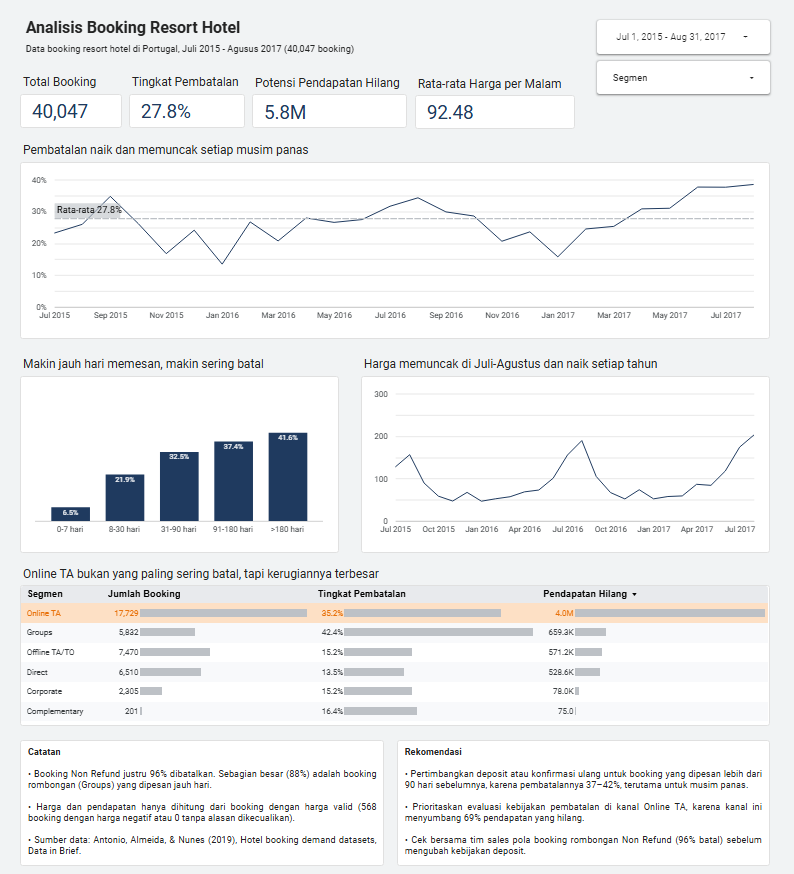

# Resort Booking: Analisis Pembatalan dan Pendapatan Resort Hotel

Analisis 40 ribu booking asli sebuah resort hotel di Portugal (2015–2017): cleaning dan analisis di Google Sheets, lalu dashboard satu halaman di Looker Studio.



**[Buka dashboard](https://datastudio.google.com/reporting/834503d3-e241-4bd4-88fc-d4a30c9a40d8)** · **[Buka spreadsheet](https://docs.google.com/spreadsheets/d/10HApo--aQYIdM_aiBz3xmxo12WeSh_oMMv7A8KyqnK4/edit?usp=sharing)** · **Tools:** Google Sheets, Looker Studio

## Ringkasan Temuan

- **27,8% booking dibatalkan**, dan naik dari 26,8% menjadi 30,8% (Jan–Agu 2016 dibanding Jan–Agu 2017). Paling tinggi di musim panas, saat resort paling sibuk.
- **Makin jauh hari memesan, makin sering batal:** 6,5% untuk booking 0–7 hari sebelumnya, 41,6% untuk lebih dari 180 hari.
- **Harga per malam di bulan Agustus sekitar 4 kali harga Januari**, dan naik setiap tahun.
- **Online TA menyumbang 68,6% dari potensi pendapatan yang hilang** (4,00 dari 5,84 juta), padahal tingkat pembatalan tertinggi ada di Groups.

## Rekomendasi

1. Pertimbangkan deposit atau konfirmasi ulang untuk booking yang dipesan lebih dari 90 hari sebelumnya, terutama untuk musim panas.
2. Prioritaskan evaluasi kebijakan pembatalan di kanal Online TA.
3. Cek pola booking rombongan Non Refund (96% batal) bersama tim sales sebelum mengubah kebijakan deposit.

---

<details>
<summary><b>Data</b></summary>

<br>

Data asli dari sistem reservasi sebuah resort hotel di Algarve, Portugal, dipublikasikan oleh Antonio, Almeida, dan Nunes (2019) dalam [*Hotel booking demand datasets*](https://repositorio.iscte-iul.pt/bitstream/10071/16929/1/Hotelbookingdemanddatasets.pdf), *Data in Brief*. File diambil dari [repositori TidyTuesday](https://rfordatascience.github.io/tidytuesday/data/2020/2020-02-11/readme.html). Informasi yang bisa mengidentifikasi hotel dan tamu sudah dihapus oleh penelitinya.

- **File:** `H1.csv` (Resort Hotel). Data City Hotel (`H2.csv`) tidak dipakai supaya analisis fokus ke satu jenis hotel.
- **Periode:** kedatangan Juli 2015 – Agustus 2017
- **Ukuran:** 40.060 booking dan 31 kolom (40.047 setelah cleaning)

</details>

<details>
<summary><b>Alur Pengerjaan</b></summary>

<br>

1. **Import:** H1.csv dimasukkan ke sheet `raw`, yang tidak pernah diubah.
2. **Pengecekan** (sheet `checks`): setiap temuan dihitung dengan rumus, sebelum dan sesudah cleaning.
3. **Cleaning** (sheet `clean` dan `cleaning_log`): perbaikan dilakukan di salinan data, dan setiap keputusan dicatat beserta alasannya.
4. **Kolom bantu:** `PriceValid`, `ArrivalDate`, `TotalNights`, `BookingValue` (harga per malam × jumlah malam), dan `LeadTimeGroup`.
5. **Analisis** (sheet `analysis` dan `pivot_q1`–`pivot_q4`): pola ditemukan lewat pivot table, lalu angka utamanya dihitung ulang dengan rumus.
6. **Dashboard:** Looker Studio terhubung langsung ke sheet `clean`, dan angkanya dicocokkan dengan sheet `analysis`.

</details>

<details>
<summary><b>Log Cleaning</b></summary>

<br>

| Temuan | Jumlah | Keputusan |
| --- | --- | --- |
| Spasi berlebih di kolom teks file asli | – | Otomatis terbuang saat diimpor (dicek dengan `LEN`) |
| `Country` berisi NULL | 464 | Diganti `Unknown` |
| `Agent` berisi NULL | 8.209 | Diganti `No Agent` (NULL berarti tidak lewat agen, bukan data hilang) |
| `Company` berisi NULL | 36.952 | Diganti `No Company` (NULL berarti bukan booking perusahaan) |
| `Meal` berisi Undefined | 1.169 | Digabung ke `SC` (menurut kamus data, keduanya berarti tanpa paket makan) |
| Booking tanpa tamu | 13 | Dihapus |
| Harga per malam negatif, atau 0 di luar segmen Complementary | 568 | Ditandai `PriceValid = FALSE`, nilainya tidak diubah, dan dikecualikan dari analisis harga |
| Harga per malam 0 di segmen Complementary | 172 | Dibiarkan (kamar memang gratis) |
| Total malam menginap 0 | 381 | Dibiarkan |
| Baris yang identik dengan baris lain | 6.091 | Dibiarkan, karena tanpa ID booking bisa saja beberapa kamar dalam satu rombongan |
| Periode tidak penuh (2015 mulai Juli, 2017 berhenti Agustus) | – | Perbandingan antartahun memakai bulan yang sama |

</details>

<details>
<summary><b>Temuan Lengkap</b></summary>

<br>

**1. Tingkat dan pola pembatalan.** Sebanyak 11.120 dari 40.047 booking dibatalkan. Di bulan yang sama, pembatalan 2017 lebih tinggi di 7 dari 8 bulan. Juni–September mencapai 31–33%, sedangkan Januari 14,8%. Musim panas juga periode tersibuk: di 2016, malam kamar terisi di bulan Agustus 5.674, dibanding 1.946 di Januari.

**2. Booking yang paling sering batal.** Booking Non Refund justru 96% dibatalkan. Sebanyak 88% di antaranya berasal dari segmen Groups, dengan rata-rata pemesanan 184 hari sebelumnya (semua booking: 93 hari). Per segmen, pembatalan tertinggi ada di Groups (42,4%) dan Online TA (35,2%), terendah di Direct (13,5%).

**3. Harga per malam.** Di 2016, rata-rata harga Agustus 189,47 dan Januari 46,64. Tidak ada bulan yang lebih murah dari bulan yang sama di tahun sebelumnya.

**4. Potensi pendapatan hilang.** Totalnya 5,84 juta, atau 33,5% dari total nilai booking. Groups hanya menyumbang 659 ribu karena jumlah booking-nya jauh lebih kecil. Online TA juga sumber pendapatan terbesar (51,3% dari total nilai booking), jadi pembatalannya perlu dikelola, bukan kanalnya dihindari.

</details>

<details>
<summary><b>Keputusan Desain Dashboard</b></summary>

<br>

- **Metrik utama: tingkat pembatalan.** Pendapatan hilang dipakai sebagai konteks dampaknya.
- **Grain bulanan**, supaya pola musiman terlihat. *Trade-off:* perubahan mingguan tidak terlihat.
- **Biru tua sebagai warna dasar, oranye sebagai satu-satunya sorotan** (Online TA). Pasangan biru-oranye juga aman untuk pembaca buta warna.
- **Tingkat pembatalan, jumlah booking, dan pendapatan hilang dalam satu tabel**, supaya persentase selalu ditemani angka absolut. Tanpa itu, Groups akan terlihat sebagai masalah terbesar.
- **Garis rata-rata tetap (27,8%) di grafik tren** sebagai pembanding. *Trade-off:* garis ini tidak berubah saat filter dipakai.

</details>

<details>
<summary><b>Batasan</b></summary>

<br>

- Potensi pendapatan hilang adalah batas atas, karena sebagian kamar mungkin terjual lagi dan deposit Non Refund mungkin tetap dibayar.
- Harga tidak mencantumkan mata uang (kemungkinan euro).
- Tanpa ID booking, baris yang identik tidak bisa dipastikan duplikat.
- Temuan menunjukkan pola, bukan sebab-akibat.
- Data hanya mencakup satu resort pada 2015–2017.

</details>

<details>
<summary><b>Struktur Repository</b></summary>

<br>

```
resort-booking-analysis/
├── README.md
├── data/
│   └── H1.csv
└── dashboard/
    └── dashboard.png
```

</details>
